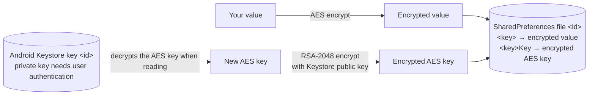

# GOV.UK One Login secure store for Android

[](https://github.com/govuk-one-login/mobile-android-secure-store/actions/workflows/on_push-main.yml)
[](https://sonarcloud.io/summary/new_code?id=mobile-android-secure-store)
[](https://github.com/govuk-one-login/mobile-android-secure-store/releases)

An Android library for storing small pieces of sensitive data, such as tokens, encrypted on the device. You can choose whether reading the data needs the user's device passcode, strong biometrics, or neither.

The library:

- encrypts each value before saving it to SharedPreferences, and decrypts it when you read it
- keeps its encryption keys in the [Android Keystore](https://developer.android.com/privacy-and-security/keystore), so they cannot be copied off the device
- shows the system [BiometricPrompt](https://developer.android.com/identity/sign-in/biometric-auth) when reading protected data
- has a `suspend` API that you call from coroutines

The public API is the `SecureStoreAsyncV2` interface. The implementation is `SharedPrefsStoreAsyncV2`.

### Limitations

- Requires Android 10 (API level 29) or later.
- Stores `String` values only. Serialise other types yourself, for example as JSON.
- Designed for small values. It is not a replacement for an encrypted database.
- Stored data cannot be restored from a backup or moved to another device. See [Exclude the store from backups](#exclude-the-store-from-backups).
- Data in a protected store becomes permanently unreadable if the user removes their screen lock or enrols new biometrics. See [Errors and how to fix them](#errors-and-how-to-fix-them).

### Contents

- [Examples](#examples)
- [Before you start](#before-you-start)
- [Get started](#get-started)
- [Configure the store](#configure-the-store)
- [Test your integration](#test-your-integration)
- [How the encryption works](#how-the-encryption-works)
- [Get support](#get-support)
- [Contribute](#contribute)
- [Licence](#licence)

## Examples

Save and read a value in a store that does not need the user to authenticate:

```kotlin
store.upsert("sessionId", "abc-123")

val sessionId: String? = store.retrieve("sessionId")["sessionId"]
```

Read values from a store that needs the user's passcode or biometrics. The system prompt appears and the call completes after the user authenticates:

```kotlin
val tokens = store.retrieveWithAuthentication(
    "refreshToken", "idToken",
    authPromptConfig = AuthenticatorPromptConfiguration(title = "Authenticate to continue"),
    context = activity,
)
```

## Apps that use this library

- [GOV.UK One Login app](https://github.com/govuk-one-login/mobile-android-one-login-app)


## Before you start

You need:

- an Android app with `minSdk` 29 or higher
- Kotlin and [kotlinx.coroutines](https://github.com/Kotlin/kotlinx.coroutines)
- a GitHub personal access token with the `read:packages` scope, because the library is published to [GitHub Packages](https://docs.github.com/en/packages/working-with-a-github-packages-registry/working-with-the-gradle-registry)

To read from a protected store, your screen must be a `FragmentActivity` (`AppCompatActivity` and `ComponentActivity`-based Compose activities that extend it are fine).

The library depends on:

- [androidx.biometric](https://developer.android.com/jetpack/androidx/releases/biometric) – shows the passcode and biometric prompt
- [androidx.core](https://developer.android.com/jetpack/androidx/releases/core) and [androidx.appcompat](https://developer.android.com/jetpack/androidx/releases/appcompat)
- [govuk-one-login/mobile-android-pipelines](https://github.com/govuk-one-login/mobile-android-pipelines) – shared build and release configuration, used only when building this repository

## Get started

1. Add the GitHub Packages repository to `settings.gradle.kts`.

    ```kotlin
    dependencyResolutionManagement {
        repositories {
            maven {
                url = uri("https://maven.pkg.github.com/govuk-one-login/mobile-android-secure-store")
                credentials {
                    username = providers.gradleProperty("gpr.user").orNull ?: System.getenv("GITHUB_ACTOR")
                    password = providers.gradleProperty("gpr.token").orNull ?: System.getenv("GITHUB_TOKEN")
                }
            }
        }
    }
    ```

2. Add your GitHub username and token to `~/.gradle/gradle.properties`. Do not commit them.

    ```properties
    gpr.user=your-github-username
    gpr.token=your-personal-access-token
    ```

3. Add the library to your version catalogue. Check [Releases](https://github.com/govuk-one-login/mobile-android-secure-store/releases) for the latest version.

    ```toml
    [versions]
    secure-store = "2.0.1"

    [libraries]
    secure-store = { group = "uk.gov.securestore", name = "app", version.ref = "secure-store" }
    ```

4. Add the dependency to your module's `build.gradle.kts`.

    ```kotlin
    dependencies {
        implementation(libs.secure.store)
    }
    ```

5. Create and initialise a store. You must call `init` before any other method.

    ```kotlin
    val store: SecureStoreAsyncV2 = SharedPrefsStoreAsyncV2()

    store.init(
        context = applicationContext,
        configurationAsync = SecureStorageConfigurationAsync(
            id = "session-store",
            accessControlLevel = AccessControlLevel.OPEN,
        ),
    )
    ```

6. Save a value and read it back.

    ```kotlin
    lifecycleScope.launch {
        store.upsert("sessionId", "abc-123")

        val values = store.retrieve("sessionId")
        Log.d("SecureStore", "sessionId = ${values["sessionId"]}")
    }
    ```

`retrieve` returns a map with an entry for every key you asked for. The value is `null` if nothing is stored for that key.

## Configure the store

### Configuration options

You configure each store with `SecureStorageConfigurationAsync`.

| Property | Required | Description |
| --- | --- | --- |
| `id` | Yes | Names both the SharedPreferences file and the Keystore key. Do not change it once your app is released, or existing data becomes unreadable. |
| `accessControlLevel` | Yes | Whether reading data needs the user to authenticate. See [Access control levels](#access-control-levels). |
| `dispatcher` | No | The coroutine dispatcher used for encryption work. Defaults to `Dispatchers.IO`. Override it in tests. |

Use a separate store, with its own `id`, for each access control level you need.

### Access control levels

| Level | Saving data | Reading data | What the user sees when reading |
| --- | --- | --- | --- |
| `OPEN` | `upsert` | `retrieve` | Nothing |
| `PASSCODE` | `upsert` | `retrieveWithAuthentication` | Device PIN, pattern or password prompt |
| `PASSCODE_AND_BIOMETRICS` | `upsert` | `retrieveWithAuthentication` | Strong biometric prompt, with passcode as a fallback |

Saving data never shows a prompt. Only reading protected data does.

If you call `retrieve` on a protected store, or `retrieveWithAuthentication` on an `OPEN` store, the library throws `SecureStorageErrorV2`.

### Create one instance per store

Each store holds its configuration in memory. Create it once and share it, for example through dependency injection:

```kotlin
@Module
@InstallIn(SingletonComponent::class)
object SecureStoreModule {

    @Provides
    @Singleton
    @Named("tokens")
    fun provideTokenStore(@ApplicationContext context: Context): SecureStoreAsyncV2 =
        SharedPrefsStoreAsyncV2().apply {
            init(
                context,
                SecureStorageConfigurationAsync(
                    id = "tokens",
                    accessControlLevel = AccessControlLevel.PASSCODE_AND_BIOMETRICS,
                ),
            )
        }
}
```

### Read data from a protected store

Pass the keys you want, the text for the prompt, and the current `FragmentActivity`:

```kotlin
class UnlockActivity : FragmentActivity() {

    @Inject @Named("tokens") lateinit var store: SecureStoreAsyncV2

    private fun unlock() = lifecycleScope.launch {
        val values = store.retrieveWithAuthentication(
            "refreshToken", "idToken",
            authPromptConfig = AuthenticatorPromptConfiguration(
                title = "Authenticate to continue",
                subTitle = "Confirm it's you",
                description = "We need to check it's you before showing your details",
            ),
            context = this@UnlockActivity,
        )
        val refreshToken = values["refreshToken"]
    }
}
```

Each call shows the prompt once, so ask for all the keys you need in a single call.

If the user's biometric does not match, the prompt stays open so they can try again. The call only completes when the user authenticates, cancels, or a terminal error happens.

### Update, check and delete data

```kotlin
store.upsert("refreshToken", newToken) // adds the value, or replaces it if the key exists

store.exists("refreshToken")           // true if a value is stored for the key

store.delete("refreshToken")           // deletes one value
store.deleteAll()                      // deletes every value and the store's Keystore key
```

`upsert` returns the encrypted value, not the value you passed in.

### Choose your keys

The library stores each value under your key, and its encrypted AES key under the same name with `Key` added to the end. Do not use 2 keys that differ only by a `Key` suffix, such as `token` and `tokenKey`, in the same store.

### Exclude the store from backups

Android's Auto Backup copies SharedPreferences files to the user's Google account and to new devices. It cannot copy Keystore keys. If the store's file is restored without its key, the app sees the data but cannot decrypt it.

Exclude the store's file, named after its `id`, from both cloud backup and device transfer:

```xml
<!-- res/xml/data_extraction_rules.xml (Android 12 and later) -->
<data-extraction-rules>
    <cloud-backup>
        <exclude domain="sharedpref" path="tokens.xml" />
    </cloud-backup>
    <device-transfer>
        <exclude domain="sharedpref" path="tokens.xml" />
    </device-transfer>
</data-extraction-rules>
```

Reference this file with `android:dataExtractionRules` in your manifest. For Android 11 and earlier, add the same exclusions to the file referenced by `android:fullBackupContent`.

On apps targeting Android 12 or later, `android:allowBackup="false"` does not stop device-to-device transfer, so you still need the `<device-transfer>` exclusion.

## Test your integration

### Run the library's own tests

Clone the repository with its submodule, then run the tests:

```bash
git clone --recurse-submodules https://github.com/govuk-one-login/mobile-android-secure-store.git
cd mobile-android-secure-store

./gradlew testDebugUnitTest            # unit tests
./gradlew connectedDebugAndroidTest    # instrumented tests, needs an emulator or device
```

The instrumented tests use the real Android Keystore, so run them on an emulator or device with a screen lock set.

### Use a fake store in your app's unit tests

Depend on the `SecureStoreAsyncV2` interface, not the implementation. You can then replace it with an in-memory fake in unit tests:

```kotlin
class FakeSecureStore(
    var authError: SecureStorageErrorV2? = null, // set this to simulate a cancelled or failed prompt
) : SecureStoreAsyncV2 {
    private val data = mutableMapOf<String, String>()

    override fun init(context: Context, configurationAsync: SecureStorageConfigurationAsync) = Unit
    override suspend fun upsert(key: String, value: String): String = value.also { data[key] = it }
    override fun delete(key: String) { data.remove(key) }
    override suspend fun deleteAll() = data.clear()
    override fun exists(key: String) = key in data
    override suspend fun retrieve(vararg key: String) = key.associateWith { data[it] }
    override suspend fun retrieveWithAuthentication(
        vararg key: String,
        authPromptConfig: AuthenticatorPromptConfiguration,
        context: FragmentActivity,
    ): Map<String, String?> {
        authError?.let { throw it }
        return key.associateWith { data[it] }
    }
}
```

### Errors and how to fix them

Every method throws `SecureStorageErrorV2` when something goes wrong. Its `type` tells you what to do next. Coroutine cancellation is never wrapped, so structured concurrency still works.

| Error type | What it means | What to do |
| --- | --- | --- |
| `USER_CANCELLED` | The user closed the prompt | Let the user try again |
| `NO_LOCAL_AUTH_ENABLED` | The device has no screen lock, or no biometrics enrolled | Ask the user to set one up in their device settings |
| `RECOVERABLE` | A temporary problem with the prompt or storage | Try again |
| `UNRECOVERABLE` | The Keystore key is missing or no longer valid, for example after a backup restore, a new biometric enrolment, or the screen lock being removed | Call `deleteAll()` and ask the user to sign in again. The stored data cannot be recovered. |

```kotlin
try {
    val values = store.retrieveWithAuthentication(
        "refreshToken",
        authPromptConfig = promptConfig,
        context = activity,
    )
    onUnlocked(values)
} catch (e: SecureStorageErrorV2) {
    when (e.type) {
        SecureStoreErrorTypeV2.USER_CANCELLED -> showUnlockAgainButton()
        SecureStoreErrorTypeV2.NO_LOCAL_AUTH_ENABLED -> askUserToSetUpScreenLock()
        SecureStoreErrorTypeV2.RECOVERABLE -> showTryAgain()
        SecureStoreErrorTypeV2.UNRECOVERABLE -> {
            store.deleteAll()
            goToSignIn()
        }
    }
}
```

Other error messages you may see:

| Message | Fix |
| --- | --- |
| `Must call init on SecureStore first!` | Call `init` before any other method |
| `Access control level must be OPEN to use this retrieve method` | Use `retrieveWithAuthentication` for this store |
| `Use retrieve method, access control is set to OPEN, no need for auth` | Use `retrieve` for this store |

## How the encryption works



- Each value is encrypted with its own AES key.
- That AES key is encrypted with an RSA key pair that the library creates in the Android Keystore the first time the store is used.
- For `PASSCODE` and `PASSCODE_AND_BIOMETRICS` stores, the private key can only be used for 15 seconds after the user authenticates.
- The private key never leaves the Keystore, and is hardware-backed on devices that support it.

Further reading:

- [Android Keystore system](https://developer.android.com/privacy-and-security/keystore)
- [Show a biometric authentication dialog](https://developer.android.com/identity/sign-in/biometric-auth)
- [Back up user data with Auto Backup](https://developer.android.com/identity/data/autobackup)

## Get support

[Raise an issue](https://github.com/govuk-one-login/mobile-android-secure-store/issues) in this repository for bugs and questions.

To report a security vulnerability, do not raise a public issue. Follow the [security policy](https://github.com/govuk-one-login/mobile-android-secure-store/security/policy).

## Contribute

Read [CONTRIBUTING.md](CONTRIBUTING.md) to find out how to set up the project, make changes and release a new version.

All contributors must follow the [code of conduct](https://github.com/govuk-one-login/mobile-android-secure-store?tab=coc-ov-file).

## Licence

Unless stated otherwise, the codebase is released under the [MIT License](LICENSE). This covers both the codebase and any sample code in the documentation.

The documentation is [© Crown copyright](https://www.nationalarchives.gov.uk/information-management/re-using-public-sector-information/uk-government-licensing-framework/crown-copyright/) and available under the terms of the [Open Government Licence v3.0](https://www.nationalarchives.gov.uk/doc/open-government-licence/version/3/).

